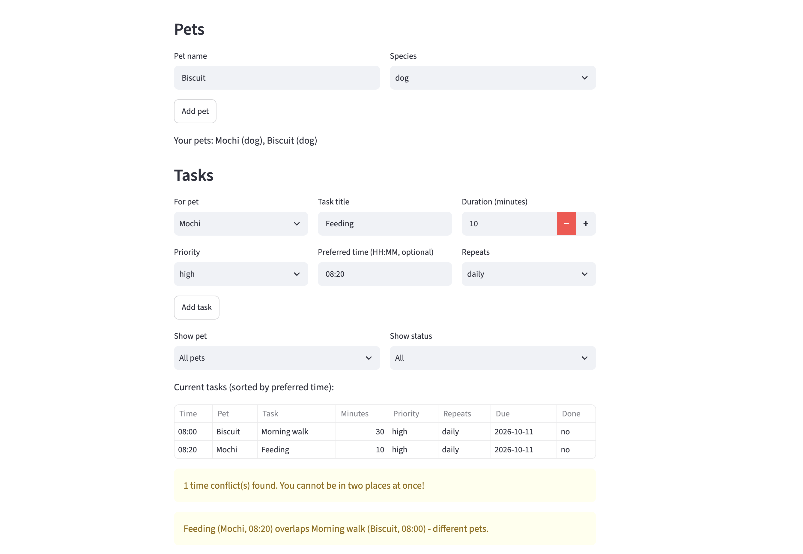
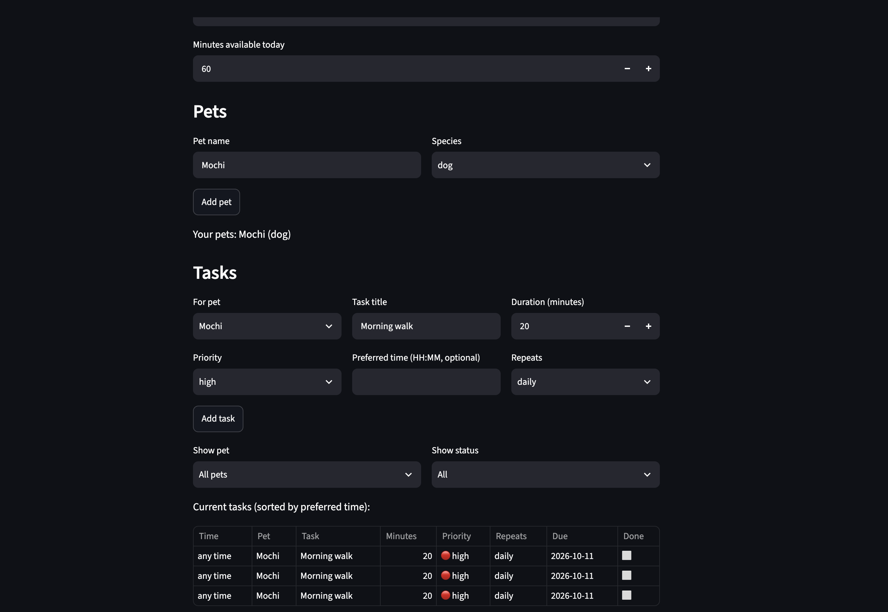

# PawPal+ (Module 2 Project)

You are building **PawPal+**, a Streamlit app that helps a pet owner plan care tasks for their pet.

## Scenario

A busy pet owner needs help staying consistent with pet care. They want an assistant that can:

- Track pet care tasks (walks, feeding, meds, enrichment, grooming, etc.)
- Consider constraints (time available, priority, owner preferences)
- Produce a daily plan and explain why it chose that plan

Your job is to design the system first (UML), then implement the logic in Python, then connect it to the Streamlit UI.

## What you will build

Your final app should:

- Let a user enter basic owner + pet info
- Let a user add/edit tasks (duration + priority at minimum)
- Generate a daily schedule/plan based on constraints and priorities
- Display the plan clearly (and ideally explain the reasoning)
- Include tests for the most important scheduling behaviors

## ✨ Features

- **Owner, pets, and tasks:** add an owner with daily minutes, add many pets, and add tasks with a duration, priority, optional preferred time, and how often it repeats.
- **Priority-based daily plan:** `generate_plan()` takes tasks high first, then medium, then low. For the same priority, tasks with a time come first, then shorter ones. It adds a task only if it fits in the minutes left, and skips the rest.
- **Sorting by time:** `sort_by_time()` puts tasks in clock order using their "HH:MM" text. Tasks with no time go last. It gives back a new list.
- **Filtering:** `filter_tasks()` shows tasks for one pet, by done or not done, or both.
- **Daily and weekly recurrence:** when you finish a daily task, a new copy is made for tomorrow. Weekly makes one for 7 days later. "once" tasks do not repeat. Future copies stay out of today's plan.
- **Conflict warnings:** `find_conflicts()` checks every pair of timed tasks and warns when they overlap, for the same pet or for different pets. Back-to-back tasks are fine. Bad times like "8am" are ignored, so it never crashes.
- **Explained plan:** `explain_plan()` says why each task was added or skipped.

## Getting started

### Setup

```bash
python -m venv .venv
source .venv/bin/activate  # Windows: .venv\Scripts\activate
pip install -r requirements.txt
```

### Suggested workflow

1. Read the scenario carefully and identify requirements and edge cases.
2. Draft a UML diagram (classes, attributes, methods, relationships).
3. Convert UML into Python class stubs (no logic yet).
4. Implement scheduling logic in small increments.
5. Add tests to verify key behaviors.
6. Connect your logic to the Streamlit UI in `app.py`.
7. Refine UML so it matches what you actually built.

## 🖥️ Sample Output

Output from running `python main.py`:

```
Today's Schedule for Sam
========================================================
Time         Task              Pet       Priority
--------------------------------------------------------
08:00-08:10  Feeding           Mochi     high
08:10-08:40  Morning walk      Biscuit   high
08:40-08:45  Give medicine     Mochi     high
08:45-09:05  Play with toys    Mochi     medium
--------------------------------------------------------
Total: 65 of 90 min

Skipped (not enough time):
  - Grooming (40 min, low)

Why this plan:
Sam has 90 minutes today. Tasks are picked by priority (high first), then by time and length.
- 08:00: Feeding (10 min, high) was added.
- 08:10: Morning walk (30 min, high) was added.
- 08:40: Give medicine (5 min, high) was added.
- 08:45: Play with toys (20 min, medium) was added.
- Grooming (40 min, low) was skipped, not enough time left.
```

## 🧪 Testing PawPal+

Run the tests with:

```bash
python -m pytest
```

My 27 tests check the main things the scheduler must do:

- **Sorting:** tasks come out in clock order, tasks with no time go last, an empty list works, and the original list is not changed.
- **Recurring tasks:** a daily task makes a new one for tomorrow, a weekly one for 7 days later, and a "once" task makes nothing. I also test Jan 31 going to Feb 1, and that the new copy is a separate task.
- **Conflicts:** same time, overlapping, and one task inside another all give a warning. Back-to-back tasks, tasks with no time, and bad times like "8am" give no warning and no crash.
- **Plan:** high priority goes first, a task that exactly fits is added, a big task is skipped but a small one after it still fits, and a pet with no tasks or 0 minutes gives an empty plan.
- **Filtering and explain:** filter by pet and by done status, and the explanation says which tasks were added or skipped.

Test output:

```
============================= test session starts ==============================
platform darwin -- Python 3.14.7, pytest-9.1.1, pluggy-1.6.0
rootdir: /Users/anishbashyal/Desktop/CodePath/ai110-module2show-pawpal-starter
collected 27 items

tests/test_pawpal.py ...........................                         [100%]

============================== 27 passed in 0.01s ==============================
```

**Confidence Level: ★★★★☆ (4 out of 5)**

All 27 tests pass, and they cover the happy paths and the edge cases I could think of. I am not giving 5 stars because the tests do not check the Streamlit UI, and the plan does not move tasks to fix conflicts, it only warns.

## 📐 Smarter Scheduling

| Feature            | Method(s)                                     | Notes                                                      |
| ------------------ | --------------------------------------------- | ---------------------------------------------------------- |
| Sorting by time    | `Scheduler.sort_by_time()`                    | "HH:MM" text sorts in clock order, tasks with no time last |
| Filtering          | `Owner.filter_tasks()`                        | by pet name and/or done status                             |
| Recurring tasks    | `Task.mark_complete()`, `Pet.complete_task()` | daily = +1 day, weekly = +7 days, "once" does not repeat   |
| Conflict detection | `Scheduler.find_conflicts()`                  | warns about overlapping tasks, never crashes               |

**Sorting.** `Scheduler.sort_by_time(tasks)` uses `sorted()` with a lambda key: `(t.time == "", t.time)`. Zero-padded "HH:MM" strings already sort in clock order. The `t.time == ""` part pushes tasks with no time to the end. It returns a new list. The plan itself (`generate_plan`) is still ordered by priority first, using `get_pending_tasks()`.

**Filtering.** `Owner.filter_tasks(pet_name=None, completed=None)` keeps only the tasks that match. `None` means "don't filter on this", so you can filter by pet, by status, or both. This works because `Pet.add_task()` saves the pet's name on every task (`task.pet_name`).

**Recurring tasks.** Each task has a `frequency` ("once", "daily", "weekly") and a `due_date`. When you call `Pet.complete_task(task)`, it runs `Task.mark_complete()`, which marks the task done and returns a new copy. The copy's due date is today + 1 day (daily) or today + 7 days (weekly), worked out with `timedelta`. "once" tasks return nothing. `Scheduler.get_pending_tasks()` skips tasks due in the future, so tomorrow's copy does not show up in today's plan.

**Conflict detection.** `Scheduler.find_conflicts(tasks)` looks at every pair of tasks that have a preferred time. Two tasks overlap if each one starts before the other ends. Back-to-back tasks are fine. It returns a list of warning messages (empty if none), says whether the clash is the same pet or different pets, and never raises an error.

Tradeoff: conflicts are checked on the times the owner asked for. `generate_plan()` does not move tasks around to fix them. See `reflection.md` section 2b.

## 🎯 Priority Scheduling

Every task has a priority: low, medium, or high. `Scheduler.get_pending_tasks()` sorts by priority first, then by preferred time, then by length. `generate_plan()` goes through that list and adds each task if it fits in the minutes left.

The last part of `python main.py` shows this. The owner has 30 minutes. The high priority walk has the latest time (18:00) but still goes first. The medium task no longer fits, but the small low task still does:

```
========================================================
Priority scheduling demo (30 minutes available)
  08:00  Long walk     🔴 high
  08:25  Quick cuddle  🟢 low
  skipped: Brush teeth   🟡 medium
Total: 30 of 30 min
```

## 🎨 Output Formatting

- **Priority dots:** 🔴 high, 🟡 medium, 🟢 low. They come from the `PRIORITY_ICON` dictionary in `pawpal_system.py`.
- **Done status:** ✅ for done and ⬜ for not done.
- **Where:** the CLI output in `main.py` and the tables in `app.py`.
- **No extra library.** It is only a dictionary and f-strings.

## 📐 Final UML

The final diagram is in [diagrams/uml_final.mmd](diagrams/uml_final.mmd). Compared to my first UML, I added these:

- **Task:** `pet_name` and `due_date`, and `mark_complete()` now returns the next copy.
- **Pet:** `complete_task()`, which adds the next copy of a repeating task.
- **Owner:** `filter_tasks()`.
- **Scheduler:** `sort_by_time()`, `find_conflicts()`, and two small helpers, `_is_valid_time()` and `_minutes()`.

## 📸 Demo Walkthrough

**Run it:** `streamlit run app.py` for the web app, or `python main.py` for the CLI demo.

**What you can do in the app**

- Set the owner name and the minutes available today.
- Add pets (name and species).
- Add tasks for a pet, with duration, priority, preferred time (optional), and repeats (daily, weekly, once).
- See all tasks in a table sorted by time, and filter them by pet and by done status.
- See warnings if two timed tasks overlap.
- Click **Done** on a task. If it repeats, the next one is made automatically.
- Click **Generate schedule** to see the plan, the skipped tasks, and why.

**Example workflow**

1. Enter the owner name `Sam` and `90` minutes.
2. Add two pets: `Biscuit` (dog) and `Mochi` (cat).
3. Add tasks, like Biscuit's "Morning walk" (30 min, high, `08:00`) and Mochi's "Feeding" (10 min, high, `08:20`).
4. Look at the task table. It is sorted by time, and tasks with no time are last.
5. See the yellow conflict warning, because the walk (08:00-08:30) overlaps the feeding (08:20). Change one time to fix it.
6. Click **Done** on Feeding. A new Feeding appears for tomorrow.
7. Click **Generate schedule** to view today's plan.

**Scheduler behaviors you can see**

- **Sorting:** the task table is always in clock order.
- **Filtering:** the pet and status dropdowns change which tasks show.
- **Conflict warnings:** overlapping times show `st.warning` messages with both task names.
- **Recurrence:** finishing a daily or weekly task adds a new copy with a later due date.
- **Priority and time limit:** the plan fits the high priority tasks first and skips what does not fit.

**Sample CLI output** from `python main.py`:

```
Today's Schedule for Sam
========================================================
Time         Task              Pet       Priority
--------------------------------------------------------
08:00-08:10  Feeding           Mochi     🔴 high
08:10-08:40  Morning walk      Biscuit   🔴 high
08:40-08:45  Give medicine     Mochi     🔴 high
08:45-09:05  Play with toys    Mochi     🟡 medium
--------------------------------------------------------
Total: 65 of 90 min

Skipped (not enough time):
  - Grooming (40 min, 🟢 low)

Why this plan:
Sam has 90 minutes today. Tasks are picked by priority (high first), then by time and length.
- 08:00: Feeding (10 min, high) was added.
- 08:10: Morning walk (30 min, high) was added.
- 08:40: Give medicine (5 min, high) was added.
- 08:45: Play with toys (20 min, medium) was added.
- Grooming (40 min, low) was skipped, not enough time left.

========================================================
Sorting and filtering demo

All tasks, in the order they were added:
  08:00  Morning walk    Biscuit  ✅ done
  17:00  Grooming        Biscuit  ⬜ todo
  19:00  Evening walk    Biscuit  ⬜ todo
  08:00  Morning walk    Biscuit  ⬜ todo
  07:30  Feeding         Mochi    ⬜ todo
  12:00  Give medicine   Mochi    ⬜ todo
  18:00  Play with toys  Mochi    ⬜ todo
  --:--  Brush fur       Mochi    ⬜ todo
  06:45  Breakfast       Mochi    ⬜ todo

Sorted by time:
  06:45  Breakfast       Mochi    ⬜ todo
  07:30  Feeding         Mochi    ⬜ todo
  08:00  Morning walk    Biscuit  ✅ done
  08:00  Morning walk    Biscuit  ⬜ todo
  12:00  Give medicine   Mochi    ⬜ todo
  17:00  Grooming        Biscuit  ⬜ todo
  18:00  Play with toys  Mochi    ⬜ todo
  19:00  Evening walk    Biscuit  ⬜ todo
  --:--  Brush fur       Mochi    ⬜ todo

Only Mochi's tasks:
  07:30  Feeding         Mochi    ⬜ todo
  12:00  Give medicine   Mochi    ⬜ todo
  18:00  Play with toys  Mochi    ⬜ todo
  --:--  Brush fur       Mochi    ⬜ todo
  06:45  Breakfast       Mochi    ⬜ todo

Only completed tasks:
  08:00  Morning walk    Biscuit  ✅ done

Biscuit's tasks that are not done, sorted by time:
  08:00  Morning walk    Biscuit  ⬜ todo
  17:00  Grooming        Biscuit  ⬜ todo
  19:00  Evening walk    Biscuit  ⬜ todo

========================================================
Conflict detection demo
Warning: Feeding (Mochi, 07:30) overlaps Vet call (Biscuit, 07:35) - different pets.
Warning: Give medicine (Mochi, 12:00) overlaps Nail trim (Mochi, 12:00) - same pet.

========================================================
Priority scheduling demo (30 minutes available)
  08:00  Long walk     🔴 high
  08:25  Quick cuddle  🟢 low
  skipped: Brush teeth   🟡 medium
Total: 30 of 30 min
```



